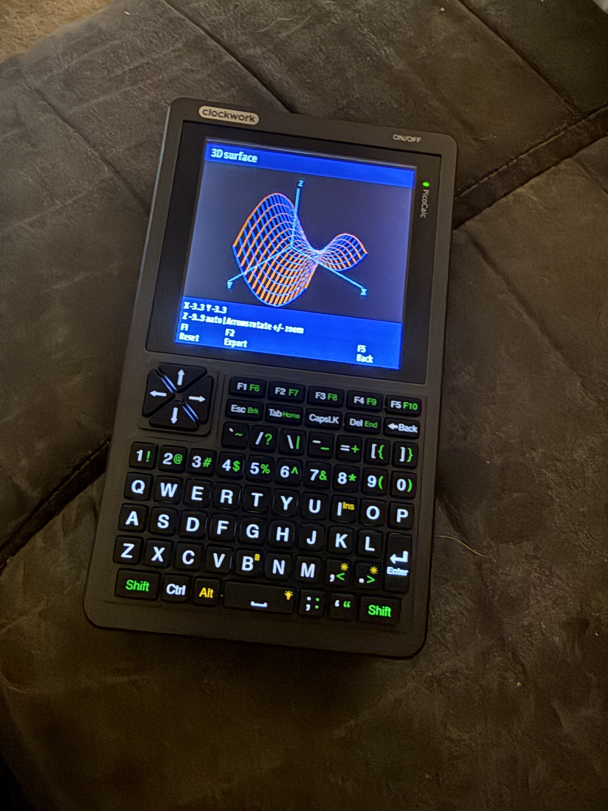

# LumaRPL

**A colour scientific and programmable calculator for the ClockworkPi PicoCalc.**

LumaRPL combines the DB48X RPL calculator engine with native graphs, guided math
workbenches and a QWERTY programming environment. It runs on an official
**Raspberry Pi Pico 2 W**, with PicoCalc PSRAM and SD storage.

[Download firmware](https://github.com/mathan416/LumaRPL/releases) ·
[User Guide](docs/manuals/pdf/LumaRPL-User-Guide.pdf) ·
[Programming Guide](docs/manuals/pdf/LumaRPL-Programming-Guide.pdf) ·
[API & Assembly Reference](docs/manuals/pdf/LumaRPL-API-Assembly-Reference.pdf) ·
[Build from source](BUILDING.md)

<p align="center">
  
</p>

## What can it do?

- **Calculate:** exact fractions, complex values, matrices, scientific functions,
  symbolic algebra and programmable RPL stack operations.
- **Graph:** 2D functions, parametric and polar curves, 3D surfaces, differential
  equations, inequalities and implicit contours. Explore roots, intersections,
  tangents and areas; export graphs.
- **Work through a problem:** guided equation solving, calculus, data and regression,
  probability, finance, engineering, units, uncertainty and signal analysis.
- **Program:** RPL, Lua scripts and native plotting APIs, CHIP-8 assembly and sprites,
  with source editors, examples, language references and error navigation.
- **Keep your work:** SD documents, saved sessions, reusable forms and notebooks.
  Optional Wi-Fi provides time synchronization and downloadable currency rates
  that remain usable offline.

Calculator design direction and device testing: **Iain Bennett**.

## Download and get started

**You do not need a compiler to use a prebuilt release.** Open
[Releases](https://github.com/mathan416/LumaRPL/releases) and choose a release with
attached assets. Release candidates are marked **Pre-release**; `dev` is the
ongoing development branch. If no assets are listed yet, a prebuilt package has
not been published. GitHub's automatic “Source code” downloads are for developers,
not SD installation packages.

### Supported hardware

- ClockworkPi PicoCalc with an official **Raspberry Pi Pico 2 W** and PicoCalc PSRAM.
- SD card and **UF2 Loader v2.4.1**, already installed and working.
- Current PicoCalc keyboard-controller BIOS for battery percentage reporting.

This application image is linked for the UF2 Loader application partition. It is
not a replacement bootloader or a generic image for other Pico/RP2040 boards.
Wi-Fi is optional; ordinary calculation does not require a network connection.

### Install or update using the SD card

1. Back up the SD card, especially its existing `db48x/` folder. Save work and
   return to the loader before removing the card from the PicoCalc.
2. Download **`LumaRPL-SD.zip`** and **`SHA256SUMS`** from the same release.
   Extract the ZIP on your computer. It contains `pico2-apps/` and `db48x/`.
3. Copy **`pico2-apps/LumaRPL-Pico-2-W.uf2`** into the card's `pico2-apps/`
   folder. Keep the existing loader and other applications.
4. Merge the supplied **`db48x/` resources** into the card's `db48x/` folder.
   Update bundled help, libraries, examples and license notices. **Keep your own
   sessions, credentials, documents and edited examples**; do not replace the
   whole folder. On an existing installation, keep existing configuration/state
   files and copy missing defaults only.
5. Safely remove the card from your computer when you are ready, return it to
   the PicoCalc, and select **LumaRPL** in UF2 Loader.
6. Open **Ctrl+T → Help & about → About LumaRPL** to check the version. Try
   `2 3 +` followed by Enter: the result is **5**.

For a SHA-256 check on macOS/Linux, compare the downloaded ZIP's digest with its
entry in `SHA256SUMS`:

```sh
shasum -a 256 LumaRPL-SD.zip
```

The separate **`LumaRPL-Pico-2-W.uf2`** asset is useful when updating only firmware
and the matching SD resources are already installed. New installations need the
SD bundle. Do not drag this loader application image to BOOTSEL as a substitute
for the documented loader workflow, or write it at an arbitrary flash address.

Without an SD card the calculator remains usable; SD saving and references need
its resources. PSRAM is volatile: it expands working storage, not permanent saves.

## Your first few controls

Boot opens the calculator stack. Press **Ctrl+T** for Home.

| Where you are | Controls |
|---|---|
| Native menus and workbenches | Arrows/Enter, visible row shortcuts 1–8, labelled F-key actions; F5 or Esc returns |
| Calculator soft menus | Tab selects a row; F1–F5 activate columns 1–5; **Ctrl+F5** activates column 6 |
| Calculator menu hierarchy | Esc returns one menu level; at the top it closes the menu; dismiss an active error first |
| Source editors | F1 Save, F2 Save & run, F4 Tools, F5 Back; read the unsaved-work prompt before closing |
| Calculator session | Ctrl+S saves; Ctrl+L loads; Ctrl+Q saves and returns to the loader, with unsaved-document protection |

Useful calculator shortcuts: **Ctrl+G** Graphs, **Ctrl+W** Math workbench,
**Ctrl+P** Programming, **Ctrl+U** Conversions, **Ctrl+A** Command Catalogue,
**Ctrl+R** Advanced RPL settings and **Ctrl+Y** Bases. Editors reuse some Ctrl
keys for text operations; shortcuts depend on the active screen.

**Help & about** contains calculator, command, Lua and CHIP-8 references with
examples. In an editor, **F4 Tools → Language reference** and **Open example**
are separate choices. Opening an example preserves your parent source and undo
history. Saving a source file is separate from saving the calculator session.

## Manuals

The illustrated **[User Guide](docs/manuals/pdf/LumaRPL-User-Guide.pdf)** teaches
stack calculation, graphs, mathematical workbenches, conversions, saving and
troubleshooting through worked examples. The **[Programming Guide](docs/manuals/pdf/LumaRPL-Programming-Guide.pdf)**
introduces RPL, Lua, CHIP-8, the editors and debugging, with language examples and
reference sections. Both include contents, bookmarks, indexes and credits. The companion
**[API & Assembly Reference](docs/manuals/pdf/LumaRPL-API-Assembly-Reference.pdf)**
gives exact Lua call contracts, CHIP-8/SUPER-CHIP instruction details and reusable
ROM routines with register contracts. [Downloadable example source](docs/manuals/examples/api)
accompanies it; native Arm development is outside its scope.

Readable source: [User Guide](docs/manuals/user-guide.md) and
[Programming Guide](docs/manuals/programming-guide.md).
[Manual build instructions and verification](docs/manuals/README.md) explain how
to regenerate the PDFs. The manuals identify their firmware baseline; newer
`dev` changes may appear before the next manual edition.

## Development

```sh
git clone --branch dev https://github.com/mathan416/LumaRPL.git
cd LumaRPL
python3 tools/bootstrap.py
# Install the toolchain and prerequisites described in BUILDING.md, then:
sh tools/build.sh
```

[BUILDING.md](BUILDING.md) lists the full Arm toolchain, Pico SDK, host-test
prerequisites, commands and packaging workflow. Bootstrap fetches pinned
upstream sources and applies the checksummed DB48X patch. Dependency checkouts
and generated builds are excluded from Git. Use the **`LumaRPL-source.tar.gz`**
release asset if you need the corresponding source bundle with dependencies;
it differs from GitHub's automatic source snapshot.

| Location | Purpose |
|---|---|
| `pico/` | PicoCalc platform, UI, hardware, native tools and language integration |
| `patches/` | DB48X source patch and file-hash manifest |
| `resources/` | Bundled SD help, examples and other resources |
| `tests/`, `tools/` | Host tests, rendering checks, builds and release tooling |
| `docs/` | Current guides, review evidence and historical port notes |
| `SOURCES.lock.json` | Pinned upstream sources and submodule revisions |

Start with [CONTRIBUTING.md](CONTRIBUTING.md),
[the release checklist](docs/RELEASE-CHECKLIST.md) and
[security reporting](SECURITY.md). Run relevant tests before submitting a change;
report host verification separately from physical-device observations. Never
commit Wi-Fi credentials, personal SD contents or session files.

## Release status and limits

The current candidate retains the original implicit-graph/optimization evaluator
and calculator memory reservations: **208 KiB arena, 96 KiB bounded heap,
32 KiB stack, 100 KiB RGB332 framebuffer and 16 KiB shared workspace**.
The arena and stack stay in internal SRAM; PSRAM holds bulk documents and graph
caches. Numerical tools have bounded work and can report unresolved problems;
a graph or local solution does not prove all solutions were found.

See [the baseline candidate review](docs/RELEASE-REVIEW.md) and
[the rc.2 update checks](docs/RELEASE-RC2.md) for the recorded build,
sanitizer, mathematics and loader checks, and remaining device acceptance.
Compilation, an SD copy or a passing host test is not a claim of physical
acceptance. [The changelog](CHANGELOG.md) distinguishes the current candidate
from its baseline. Earlier port notes in [docs/history](docs/history) are
historical, not current installation instructions.

## Credits and licensing

LumaRPL builds on **DB48X** by Christophe de Dinechin and contributors, with
ClockworkPi hardware/driver origins, UF2 Loader, Raspberry Pi Pico SDK, FatFS,
Lua, CYW43, lwIP, Mbed TLS, fonts and other acknowledged components.

The combined port is distributed under **GPL-3.0**. Upstream components and fonts
retain their own terms. Read [LICENSE](LICENSE), [NOTICE.md](NOTICE.md) and
[the component notices](licenses/). Credits distinguish calculator components,
external data and development tools. The manuals credit the cover photograph
supplied by Iain Bennett separately from software licensing.
