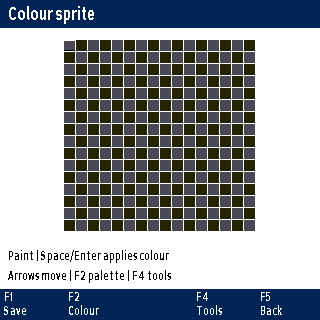

# 1 Choose a programming language

LumaRPL gives you three ways to write a program. RPL works directly with calculator objects and the stack. Lua provides conventional variables, loops, text and drawing APIs. CHIP-8 assembly targets a small virtual machine with sprites, keys and timers.

| Choose | When it is a good fit | Saved source |
| RPL | Exact calculator arithmetic, symbolic expressions, units and reusable stack operations | .48s under /db48x/data |
| Lua | Small scripts, animation, native graph callbacks and interactive tools | .lua under /db48x/lua |
| CHIP-8 assembly | Learning a small virtual machine and creating monochrome sprite programs | .asm under /db48x/chip8 |

A HOME RPL program is a calculator variable, saved with the session. An SD RPL file is an independent document. Lua and CHIP-8 use their own runtimes; a saved Lua variable or CHIP-8 register is not a HOME variable.

## Read and run examples

RPL examples introduced as calculator entries are typed at the stack and followed by Enter. Source examples go into the appropriate editor. Use Ctrl+B for `«` and Ctrl+E for `»` on the PicoCalc keyboard.

The complete CHIP-8 examples explicitly state their compatibility profile. Instruction-reference fragments explain an operation; they are not necessarily complete visible programs. Lua canvas examples need screen.show(), and a key wait when you want to keep the picture visible during a running script.

## Protect existing work

Save your calculator session before an example that stores names or changes settings. Save source with F1. Native documents and the calculator session have separate saving paths. Keep the calculator running after a failed save so you can retry without losing the working source.

The books' examples describe this LumaRPL build and keyboard. When adapting an HP RPL example, consult the current command reference for accepted names, syntax and supported objects.

# 2 The shared source editor

Press **Ctrl+P** and choose RPL files / editor, Lua scripts, or CHIP-8 / assembly. The file browser has F1 Open, F2 Run, F3 New, F4 Actions and F5 Back where those actions apply. Left/Right pages through files.

## Create, save and reopen

1. Press F3 New and choose a new name, for example FIRST.
2. Type the source for the selected language.
3. F1 saves. F2 saves and runs. F4 opens Tools. F5 returns.
4. Reopen the file with F1 to continue editing it.

A successful RPL run returns its results to the calculator stack. Lua output can return to its editor after you leave the output view. Use the displayed controls after a CHIP-8 run. Save & run does not mean that the entire calculator session has also been saved.

## Text controls

| In a source editor | Action |
| Arrows | Move the caret |
| Enter | New line |
| Tab | Insert two spaces |
| Backspace | Delete before the caret, or the selection |
| Ctrl+A | Select all |
| Ctrl+K | Start or clear a selection anchor |
| Ctrl+C / Ctrl+X / Ctrl+V | Copy / cut / paste |
| Ctrl+Z / Ctrl+Y | Undo / redo |
| Ctrl+F / Ctrl+R | Find / replace |
| Ctrl+G | Go to line |
| Ctrl+U | Unindent |
| F4 Tools | Reference, examples, insertion, find, line navigation and history |

The clipboard and individual edit operations are bounded; very large selections may need smaller operations. Keep a saved copy before a large rewrite. Source fonts use fixed cells so code columns stay aligned.

## Unsaved changes

F5 or Esc from a dirty source offers Save, Discard and Cancel, defaulting to Cancel. If a selection is active, Esc clears it first. If saving fails, the source remains available. Undo history belongs to the live editing session; do not assume it is stored in a source file across a restart.

# 3 Reference, examples and command insertion

## Language reference

In any of the three editors, open **F4 Tools > Language reference**. It opens the reference for that editor's language. Read a page, then use F5/Esc to return to the source.

## Open example is a separate choice

**F4 Tools > Open example** is beside Language reference, not inside it. Choose an example and give it a new filename. LumaRPL preserves the parent source, caret and undo history while you explore the example.

Save the example if you want to keep it. Close it to return to the parent source. One nested example is allowed; if there is not enough memory to preserve the parent safely, LumaRPL refuses the operation rather than replacing your code.

A useful check is to type an unsaved comment in your own file, open and run an example, return, and Undo. The comment and its history should still belong to your original editor session.

## Insert a command template

Tools > Insert command opens language-appropriate choices. The inserted template includes the punctuation or structure it needs and places the caret at the first useful field. Fill every required argument or placeholder before running it.

For a Lua drawing call, this saves typing the parentheses and argument separators. For an RPL control structure, it supplies the surrounding words. For assembly, it supplies an instruction form. It does not know your intended values or make an unfinished template a valid program.

Insertion is an edit: Undo can remove it, and opening the chooser or cancelling it leaves your current source intact.

# 4 Your first RPL program

RPL programs are sequences of operations between `«` and `»`. Entering the program object places it on the stack. EVAL executes its body.

## Square a number

At the calculator, enter:

```rpl
« DUP * » 'SQDEMO' STO
```

Then enter:

```rpl
12 SQDEMO
```

The answer is **144**. SQDEMO is the stored name. DUP copies the input and multiplication combines the copies. Its stack contract is `x -> x^2`.

Save with Ctrl+S if you want the HOME name after a restart. In Programming > HOME programs, selecting SQDEMO and pressing F2 Run also executes it, using the current stack inputs.

## The same program on SD

Create SQUARE in RPL files / editor and type:

```rpl
«
  DUP *
»
```

Press F1 Save. Return to the calculator, put 12 on the stack, then select SQUARE in the RPL browser and press F2 Run. The result should again be 144. F2 Save & run in the editor executes the same program body.

The Run action executes the selected outer program. It does not recursively execute every program object that the body deliberately creates. A program can legitimately leave another quoted program on the stack.

## Test the saved copy

Save the session for the HOME name. Save the SD file independently. Restart cleanly, reopen the SD source, and run it with a new input such as 5; expect 25. Loading the session and evaluating SQDEMO tests the HOME copy separately.

# 5 Design a stack contract

Write down which values a program consumes and what it leaves. RPL has no automatic local argument list unless you create one. Clear contracts make small programs reusable.

## Two inputs: a hypotenuse

Program body:

```rpl
«
  DUP *
  SWAP DUP *
  + SQRT
»
```

Contract: `a b -> sqrt(a^2+b^2)`. With 3 then 4 on the stack, the result is 5.

After squaring the top input b, SWAP brings a to the top, where DUP * squares it. Addition and SQRT finish the calculation. This works on suitable exact/calculator objects rather than converting everything to a Lua number first.

## Useful stack operations

| Command | Contract or purpose |
| DUP | x -> x x |
| SWAP | a b -> b a |
| DROP | Remove the top object |
| OVER | a b -> a b a |
| DEPTH | Push the current number of stack objects |

To learn an unfamiliar roll command, try it on a short stack of distinct values and compare the result with the reference's contract. Do not infer a roll's direction from its name alone.

## Comments and readable source

Use line breaks and indentation to separate stages. An RPL line comment starts with `@`, for example `@ Square the input` on its own line. Do not use Lua's `--` or assembly's semicolon comment marker in RPL. A short program with clear local names is often easier to maintain than a long chain of stack shuffles.

# 6 Names, quotation and local variables

## Store a value or program

`42 'ANSWER' STO` stores a value. `'ANSWER' RCL` recalls it explicitly; evaluating ANSWER also retrieves its value. For a stored program, evaluating the unquoted name runs the program.

Quotation preserves an object for later use. `'X^2+1'` is an algebraic expression; `« DUP * »` is an RPL program; `'SQDEMO'` is a name. They are useful in different contexts.

## Give inputs local names

Try this complete calculator entry:

```rpl
3 4 « -> A B « A A * B B * + SQRT » » EVAL
```

It leaves **5**. The earlier value 3 binds A and the top value 4 binds B. The local structure consumes its inputs and gives the body named values without replacing HOME variables A and B.

Use local variables when a value is used repeatedly or when a formula's meaning is obscured by stack rearrangement. Keep the stack result contract visible even when the implementation uses local names.

## Deliberately return a program

This example returns a program object rather than running it immediately:

```rpl
« « 2 3 + » » EVAL
```

The remaining object is `« 2 3 + »`. A further EVAL gives 5. This ordinary quotation behaviour is preserved by the file/browser Run actions.

# 7 Decisions and repetition in RPL

## Choose a branch

```rpl
«
  IF 2 1 > THEN
    7
  ELSE
    9
  END
» EVAL
```

The comparison is true, so the result is **7**. The code before THEN leaves a condition. THEN and ELSE should leave compatible results when later code expects a particular stack shape. ELSE is optional.

## A counted loop with a name

```rpl
0 «
  1 5 FOR K
    K +
  NEXT
» EVAL
```

This adds 1+2+3+4+5 to the initial zero, leaving **15**. FOR names the counter; NEXT advances by one. START/NEXT repeats without a named counter. STEP uses an explicit step when you need a different increment.

## Test before or after the body

```rpl
0 «
  WHILE DUP 3 < REPEAT
    1 +
  END
» EVAL
```

The result is **3**. WHILE tests before the body, so the body can run zero times. DO/UNTIL tests after the body; a true UNTIL condition ends the loop.

Every loop needs an exit path. Keep the next iteration's required values on the stack. Press Esc to interrupt a long supported calculation instead of waiting for an accidental infinite loop to finish.

# 8 Collections, units and calculator mathematics

## Lists and arrays

Lists use braces; arrays use square brackets. Try `{1 2 3} ListSum` for 6, or `[[1 2][3 4]] DET` for -2. GET/PUT access collection entries; positions start at 1.

Choose a list when it groups arbitrary objects. Choose a vector or matrix when array arithmetic expresses the problem. A list of arrays and one larger matrix are not interchangeable objects.

## Preserve physical quantities

```rpl
100_cm 1_m Convert
```

The result is one metre. Compatible dimensions are required; unit spellings are case-sensitive. Returning calculator objects from RPL preserves exactness, units and other calculator behaviour where the engine supports them.

## Display settings inside examples

Angle and decimal settings can change a result's interpretation. `Rad` selects radians; `Deg` degrees. `3 Fix` changes decimal display, while Precision changes significant digits used in decimal work.

If a reusable program deliberately changes a setting, make that side effect part of its documented contract or restore the intended setting. The native workbenches' scoped evaluation does not mean that arbitrary user RPL programs have all their side effects rolled back.

## Use the full reference

Ctrl+A opens the insertion catalogue at the calculator. Ctrl+K looks up command Help. In the editor, use Language reference or Insert command instead. The on-device reference covers more commands and settings than the selected stack-language reference in this guide.

# 9 Find and fix an RPL error

## Parse errors and runtime errors

A parse error means the source could not be read as the intended object: a missing closing delimiter is one example. A runtime error happens after valid code begins executing: a missing argument or an invalid domain is another.

When an exact source location is available, the error action can take you to that line. Otherwise RPL offers Find rather than pretending it knows an exact location. Jumping to a location moves the caret; it does not rewrite your source or erase undo history.

## A small diagnosis exercise

Create an SD program containing `« + »`. With no inputs, Run should report too few arguments. Supply two numbers on the stack and rerun it. If the result now appears, the problem was the stack contract, not the spelling of addition.

For an unmatched delimiter, correct the structure before rerunning. RPL source is parsed before a source-editor save/run path accepts it. Read the message rather than repeatedly pressing a function key on the calculator's settings menu.

## Step through a program

The RPL editor's Tools route offers Debug. F1 Step executes the next operation; F2 Over steps over; F3 Run continues; F4 Vars opens variables; F5 Stop ends the stepping session. Watch how the stack changes after each operation. Debugging executes code; stored variables or other intentional side effects still matter.

Save source and important calculator state before debugging a program that changes names, files or settings. Use a short test input with a known answer. The hypotenuse program with 3 and 4 is a useful first stepping exercise.

# 10 Your first Lua script

Press **Ctrl+P > Lua scripts > F3 New**. Name it HELLO and enter:

```lua
print("Hello, LumaRPL")
print(2+3)
```

F2 saves and runs. The output is the greeting and 5. Leave the output view to return to editing. F1 saves without running.

## Values and functions

```lua
local function square(x)
  return x*x
end
print(square(12))
```

This prints **144**. `local` keeps the name in its Lua scope. Lua's `*` multiplies values in an expression; it does not consume values from the calculator stack.

## Repeat and choose

```lua
local total=0
for i=1,5 do
  total=total+i
end
if total==15 then
  print("Correct")
end
```

The output is **Correct**. Lua uses `then`, `end` and `do` in its own syntax; RPL's delimiters and uppercase structure words are a different language.

## Use the Lua console

Ctrl+P > Lua console lets you try an expression directly. Enter `2+3` for 5, or use print for explicit output. Variables and the selected drawing-font profile persist in that Lua console session. Closing the console ends that session; it does not save variables into HOME or an SD file.

# 11 Lua libraries and the calculator bridge

## Available libraries

The embedded runner opens base functions, table, string, math, utf8 and coroutine. Standard io, os, package and debug libraries are not opened, and dofile/loadfile are removed. You cannot assume that a desktop Lua script using require or arbitrary file access will run unchanged.

This is Lua 5.4.9 with LumaRPL extensions. Its allocation budget is 48 KiB and its displayed output is bounded. Keep tables/strings small and use data incrementally when possible.

## Tables and strings

```lua
local samples={1,4,9,16}
for i,value in ipairs(samples) do
  print(i,value)
end
```

print separates multiple arguments with tabs. Tables are one-based by convention for these sequences. A very large generated table can exhaust the embedded allocation budget even if the source file is short.

## Ask the calculator for one expression

```lua
print(calc.eval("2+3"))
```

This returns **text** describing 5. The bridge accepts a single algebraic expression, not a general sequence of RPL commands or a program with quotes. Its input is limited to 240 bytes and output is bounded.

`calc.eval("1/3")` can retain calculator exact arithmetic in the rendered answer. `tonumber` is only appropriate when the returned text is a plain Lua numeric spelling; units, grouping or exact fractions need interpretation rather than blind conversion.

The bridge restores calculator stack depth and its temporary formatting override, and clears its reported error. Expressions resolve available calculator variables and use relevant calculator settings. It is not an unrestricted RPL execution API.

## Degrees and radians

Lua math.sin and math.cos use radians. For a degree input, `math.sin(math.rad(90))` gives approximately 1. A Lua math result uses Lua numeric arithmetic; a native calculator expression can have different exact/precision behaviour.

# 12 Draw with Lua

The canvas is 320 by 320 pixels. The origin is upper-left: X grows right and Y grows down. Draw into the canvas, then call screen.show() to make the frame visible.

## A first picture

```lua
screen.clear("black")
screen.text(10,10,"Hello, Iain!","cyan")
screen.line(10,35,200,35,"orange")
screen.circle(160,160,40,"green",false)
screen.show()
keyboard.wait()
```

A greeting, line and circle appear. A key wait keeps the running script's picture available until a key arrives; Esc interrupts.

Colours accept a supported name, a `#RRGGBB` string or an integer from 0 to 0xffffff. The display quantizes those requests to its 256-colour RGB332 palette. Similar requested colours can become the same displayed colour.

## Use an appropriate font

New Lua sessions start with compact proportional text: 13-pixel text and 16-pixel line spacing. `screen.font("mono")` selects compact fixed cells for aligned tables. `screen.font("legacy")` selects the previous header-font behaviour for an existing script that needs it.

`screen.font()` reads the active profile. Selecting one returns the previous profile, allowing a script to restore it. The profile stays within the Lua session; it does not change calculator settings.

## Measure before placing text

```lua
screen.clear("black")
local label="Centred"
local w,h=screen.measure(label)
screen.text(math.floor((320-w)/2),20,label)
screen.rect(8,18,304,h+4,"gray",false)
screen.show()
keyboard.wait()
```

Measurement and drawing use the same active font layout. Text outside the canvas is clipped. Multiline text uses the selected profile's layout; keep enough vertical space for every line.

## A moving dot

```lua
for x=20,280,4 do
  screen.clear("black")
  screen.circle(x,160,6,"orange",true)
  screen.show()
  system.sleep(20)
end
```

Redraw a coherent frame rather than accumulating unwanted trails. Keep loops small and let Esc interrupt. The Lua API uses the application's existing framebuffer; it does not create another full-screen buffer for your script.

# 13 Native plots from Lua

Use the native plotting API for mathematical curves and surfaces. It gives your script the same native viewing controls as the calculator's graph tools.

## Compare sine and cosine

```lua
plot.clear()
plot.window(-6.3,6.3,-2,2)
plot.function2d(function(x) return math.sin(x) end,
  {colour="cyan",label="Sine"})
plot.function2d(function(x) return math.cos(x) end,
  {colour="orange",label="Cosine"})
plot.show()
print("Returned from graph")
```

Up to three 2D curves can be registered. A callback returns a finite number, or nil for a gap. It should be a small mathematical function: avoid changing shared application state while the viewer samples it.

## A saddle surface

```lua
plot.clear()
plot.surface(function(x,y) return x*x-y*y end,
  {xmin=-3,xmax=3,ymin=-3,ymax=3})
plot.show()
```

Arrows rotate, +/- zooms and F1 resets the camera in the surface viewer. Leaving plot.show() continues the Lua script. Optional camera angles are radians, with the documented pitch and zoom limits in the API reference.

Call plot.clear() before changing to a new plot definition. Plot windows and callbacks belong to the Lua session; the API does not add general parameter-management methods for native workbenches.

# 14 Keys, timing, sound and sprites in Lua

## Read a key without blocking

keyboard.poll() returns a queued key name, or nil if none is available. keyboard.down(name) checks whether a key is held. keyboard.wait() waits; an optional positive timeout is in milliseconds. Esc remains interruption rather than an ordinary application key event.

Named keys include left, right, up, down, enter, space, backspace and f1-f5. Printable single characters can also be used. system.sleep(ms) delays cooperatively; system.millis() reads the millisecond counter. Use elapsed-time differences, not assumptions about an exact display frame rate.

## Play a short tone

```lua
sound.beep(880,150)
sound.stop()
```

The tone frequency is in hertz and duration in milliseconds. Supported nonzero frequencies are 20..16000 Hz; duration is at most 10000 ms. A zero frequency stops sound. These bounds are part of the API, not musical tuning recommendations.

## Draw a saved colour sprite

Create and save a 16 by 16 colour drawing in Sprite editor. In Lua:

```lua
screen.clear("black")
local ok,err=screen.sprite("DEMO.sprite",40,60)
if ok then
  screen.show()
  keyboard.wait()
else
  print(err)
end
```

Replace DEMO.sprite with your saved filename. Paths are restricted to the calculator's sprite directory. Transparency is respected and drawing clips to the canvas. Invalid/unavailable files return nil and an error message instead of a successful drawing.

The bundled SPRITE.lua demonstrates the format. A colour .sprite document is separate from a CHIP-8 one-bit mask and its assembly export.

# 15 Lua errors and memory

## Find the actual line

A missing parenthesis is a syntax error. Calling a nil value or dividing through an unsuitable domain can be a runtime error. On an unhandled script error, the editor can offer a line jump when the runtime provides a location.

Correct the source and rerun. Undo history is retained during supported save/run recovery. If a script catches an error with pcall, it has handled that failure itself, so there may be no unhandled-error jump to perform.

## Catch an expected failure

```lua
local ok,err=pcall(function()
  error("Try again")
end)
print(ok,type(err))
```

The output is false and string. Use pcall around a failure you can usefully recover from; do not hide every error and continue with invalid data.

## Stay within the budget

The runner bounds Lua allocations to 48 KiB. Long output is bounded too. Reduce a table, avoid repeated string concatenation in a large loop, and release references you no longer need. Save source before closing an editor or restarting.

A program can be syntactically valid and still exceed memory or computation limits. Test a small input first. The built-in Esc hook supports interruption during Lua execution, waits and native plotting callbacks.

# 16 Your first CHIP-8 assembly program

CHIP-8 is a virtual machine, not the Pico 2 W's native Arm instruction set. Programs operate on registers and memory, draw monochrome sprites and read a sixteen-key keypad.

## Draw the digit 5

Create FIRST in **Ctrl+P > CHIP-8 / assembly > F3 New**:

```asm
CLS
LD V0, 5
LD F, V0
LD V1, 10
LD V2, 8
DRW V1, V2, 5
LD V3, K
EXIT
```

Save it, return to the browser, and choose **F4 Actions > Compatibility profile > SUPER-CHIP modern**. Then press F2 Run. The digit 5 appears near the upper-left of the CHIP-8 display. Press and release X to satisfy the key wait and return.

EXIT is a SUPER-CHIP extension; using an incompatible profile changes whether the example can finish as written. The result is a picture, not the number 5 on the calculator stack.

## Source and ROM are different files

Keep FIRST.asm for editing. Running assembles a separate .ch8 ROM. Opening a ROM does not reconstruct its original assembly source or labels. Browser actions select profile and other run options.

The supplied MOVE.asm and BEEP.asm are original local demos. No proprietary HP interpreter or calculator ROM is needed to use the virtual machine.

# 17 CHIP-8 registers, labels and sprites

## Registers and numbers

V0 through VF are eight-bit registers. I is the memory index; PC is the instruction pointer. VF is also used for carry, borrow or drawing collision by instructions that specify it. Do not keep an unrelated long-lived value in VF across such an operation.

Assembler numbers use decimal or prefixes such as `0x` for hexadecimal. RPL's `#FFD2h` notation belongs to the calculator, not this assembler. Opcodes/register spellings are case-insensitive; label spelling is retained and labels are case-sensitive.

## Labels and data

A label ends with a colon. Semicolon or # begins an assembly comment. DB emits bytes; DW emits words. Programs start at 0x200 in the VM's 4096-byte memory. Assembled program/data must fit the remaining 3584 bytes.

## Draw your own eight-pixel-wide image

This complete SUPER-CHIP example draws a small box:

```asm
CLS
LD I, box
LD V0, 12
LD V1, 8
DRW V0, V1, 5
LD V2, K
EXIT
box:
DB 0xF0, 0x90, 0x90, 0x90, 0xF0
```

Each byte gives one row, most significant bit first. DRW combines pixels using XOR. Drawing the same sprite twice at the same position erases it; VF reports a collision where a previously lit pixel was turned off.

## Timers

The delay and sound timers count at 60 Hz. To make a roughly half-second sound, load 30 into a register, then copy it to ST. Poll DT in a loop if you need to wait for a timer. The timer is separate from the number of VM instructions executed per display update.

Use the reference's LD forms for fonts, BCD and memory. SAVE/LOAD can alter I differently by profile, so choose the profile expected by the source rather than adjusting a few instructions by guesswork.

# 18 Keypad and compatibility profiles

## The sixteen-key mapping

| PicoCalc keys | CHIP-8 hexadecimal keypad values |
| 1 2 3 4 | 1 2 3 C |
| Q W E R | 4 5 6 D |
| A S D F | 7 8 9 E |
| Z X C V | A 0 B F |

Press and release a mapped key for `LD Vx,K`. In the first program, X maps to zero. Esc leaves/interrupts the VM through the surrounding application; it is not one of the sixteen VM keys.

## Select the expected interpreter behaviour

Profiles are COSMAC VIP, CHIP-48, SUPER-CHIP modern and SUPER-CHIP legacy. They select historical differences in shifts, memory transfers, offset jumps, draw timing and extensions. The profile matters even when two ROMs draw the same first frame.

Choose the profile in browser Actions. When importing an outside ROM, use its documented target. A profile error is a better diagnosis than editing a working instruction blindly. XO-CHIP and arbitrary native HP/Saturn binaries are outside this VM.

## Display modes

Ordinary CHIP-8 uses 64 by 32 logical pixels. SUPER-CHIP can use 128 by 64. The PicoCalc renderer scales the virtual pixels; it does not reinterpret them as full-colour sprite documents.

HIGH/LOW, scrolling, large fonts, flags and EXIT depend on the supported profile. Read the instruction page's qualification before using an extension.

# 19 Debug assembly and use the sprite editor

## A build error

If assembly fails, read its message and source line. The error action can move the source caret to that line without destroying the file or its undo history. Check operand count, label spelling and number range first.

A runtime VM error can identify a program counter. Where its mapping is available, the editor maps that address back to source. Data directives and instructions have different sizes; an arbitrary PC is not simply the same as a source line number.

## A blank screen

First run the complete digit example from chapter 16. If that works, compare your own I/font setup, coordinates, DRW height and key wait. Loading a number into V0 alone does not draw a number.

## Paint a reusable sprite

Ctrl+P > Sprite editor opens a 16 by 16 grid. Arrows move; Space/Enter paints; Backspace erases. F2 Colour chooses an RGB332 paint colour or transparency. F1 saves. F4 Tools contains open, mode and export choices. F5 returns with unsaved-work protection.



Colour sprite mode saves a `.sprite` document under `/db48x/sprites/`, with 256 RGB332 pixel bytes and a separate transparency mask in a checked file. Lua screen.sprite() draws it with clipping and transparency.

CHIP-8 sprite mode remains one bit per pixel; selected colours affect its preview. Switching a populated colour drawing to monochrome asks first. Explicit mask export makes opaque pixels set bits and transparent pixels clear bits; the actual colour value does not determine the mask bit.

# 20 Patterns for dependable small programs

## Start with an observable result

In RPL, choose a known stack answer. In Lua, print a value or draw a labelled picture. In CHIP-8, draw a digit and wait for a key. A successful dispatch with no observable result is a poor first test.

## Keep work and execution separate

Save source before Run. Preserve a small test input. Check a result before storing it into HOME or replacing a working document. A script's working variables are not a durable SD save.

## Prefer a native plot for mathematics

Lua screen drawing is suited to a custom canvas. plot.function2d and plot.surface use the native renderer, sampling and interaction. Keep callbacks small and return nil for gaps. A graph can take time without being frozen; Esc provides the supported cancellation path.

## Treat boundaries as part of the design

| Boundary | Practical habit |
| A formula field is at most 159 bytes | Keep a longer derivation in source or on the calculator stack |
| Lua allocations are bounded | Test small tables and short strings first |
| Output is bounded | Print summaries, not an unbounded trace |
| Assembled CHIP-8 code/data fits 3584 bytes | Count data as well as instructions |
| Undo/clipboard edits are bounded | Save before a large replacement |
| PSRAM is volatile | Save to SD before power-off |

## A three-language restart test

Save SQUARE.48s, HELLO.lua and FIRST.asm. Confirm each runs. Put an unsaved comment into a parent source, open an example, run it and return; confirm the parent and Undo still work. Save the parent before leaving. Return cleanly to the loader and reopen the three source files after restart. Test their results again.

# A Selected RPL reference

This section is a working reference for the tutorials. It does not replace the full on-device command/settings reference. Inputs are written in the order you enter them; the last is the top of the stack. A parameter in parentheses is explanatory notation, not literal input.

## Stack and names

| Entry | Purpose | Example |
| DUP | Copy top | 7 DUP * gives 49 |
| SWAP | Exchange top two | 10 3 SWAP - gives -7 |
| DROP | Remove top | 1 2 DROP leaves 1 |
| OVER | Copy second | 1 2 OVER leaves 1,2,1 |
| STO | Store under quoted name | 42 'ANSWER' STO |
| RCL | Explicit recall | 'ANSWER' RCL |
| EVAL | Evaluate an object | « 2 3 + » EVAL gives 5 |

## Objects and mathematics

| Entry | Meaning or example |
| 'X^2+1' | Quoted algebraic expression |
| « DUP * » | Quoted RPL program |
| {1 2 3} | List |
| [[1 2][3 4]] | Two-row matrix |
| (1;2) | Rectangular complex value |
| 100_cm 1_m Convert | Convert centimetres to metres |
| #FFh Bin | Show hexadecimal FF in binary |
| 255 Hex | LumaRPL direct ordinary-integer conversion |
| [[1 2][3 4]] DET | Determinant -2 |
| {1 2 3} ListSum | Sum 6 |

## Settings and structure

| Entry | Effect |
| Rad / Deg / Grad | Select an angle convention |
| 3 Fix | Three displayed decimal places |
| 16 Precision | Sixteen significant decimal calculation digits |
| IF ... THEN ... ELSE ... END | Choose a branch |
| first last FOR K ... NEXT | Count with local K |
| first last START ... NEXT | Count without a named counter |
| WHILE ... REPEAT ... END | Test before each body |
| DO ... UNTIL ... END | Test after the body |
| -> A B « ... » | Bind the supplied inputs to local names |

For a sixth soft-menu column use Ctrl+F5. For a long command name use the compact label or its full reference/catalogue spelling. A setting that needs a numeric argument is not a no-argument toggle.

# B Lua API and example reference

The following entries describe the embedded API shipped with LumaRPL. Complete scripts are labelled Script; fragments are labelled Fragment. An API's optional-argument notation uses square brackets for explanation and is not typed literally into Lua.

@lua-reference

# C CHIP-8 instruction and example reference

These entries describe LumaRPL's assembler and profiles. A Fragment demonstrates an instruction without claiming to produce a visible full program. Use chapter 16's complete program as a starting ROM and keep its profile explicit.

@chip8-reference

# D Practice answers

## RPL checks

The hypotenuse program consumes 3 and 4 and returns 5. The local-variable version returns the same result without replacing HOME A/B. A nested quoted program remains a program object until a further EVAL. The counted loop sums 1 through 5 to 15.

## Lua checks

The square function prints 144; the loop prints Correct. Changing screen.font inside the console affects later console drawing in that session. calc.eval returns text, so a formatted fraction cannot be assumed to pass directly through tonumber.

## CHIP-8 checks

X is keypad value 0. DRW XORs pixels, so redrawing at the same location can erase a sprite. EXIT needs a supporting SUPER-CHIP profile. Keep .asm source even after a .ch8 ROM has been generated.

## Editor checks

Open example is a separate Tools entry. Returning from it restores the parent's working source and undo history. A source-line jump moves the caret; it is not a source rewrite. Undo history is a live-session aid, not a restart-persistent file format.


# Calculator command additions

`FFT` and `InvFFT` accept real or complex vectors with power-of-two lengths
from 1 to 1024, subject to memory. Forward coefficients are unscaled; inverse
coefficients are divided by N. Use the Signal analysis workbench when you need
windowing, demeaning or sample-rate-aware amplitude plots.

Matrix factorizations work on the RPL stack: `MatrixQR` returns Q R; `LQ` returns L Q;
`Cholesky` returns L; `SVD` returns U s V; `Schur` returns Q T. The thin SVD uses
A = U diag(s) transpose(V); Schur uses A = Q T transpose(Q). Inputs are real
matrices with dimensions up to 32, subject to memory. `SVL`, `CondNum`, `SpecRad`,
`ToDiagonal` and `FromDiagonal` return one result. `RREFMOD` uses a prime modulus
set by `CASModulus` and preserves exact integer arithmetic.

`Normal`, `Student`, `ChiSquare` and `FDistribution` return lower-tail
probabilities. Their `Inv` counterparts take a probability strictly between zero
and one. See the command reference for argument order.

`Taylor` takes expression, variable, point and order; `FiniteDifference` takes expression,
variable and step. `Limit` takes expression, variable and finite real point,
with support for analytic expressions and removable zero-over-zero singularities.
Taylor and Limit use radians for analytic trigonometric calculations.
`DerivX` and `IntVX` use the selected algebra variable. Variables in these command
arguments stay symbolic even when a stored variable has the same name.

Calculator shorthand conversion does not run inside `INPUT` prompts. Validators
receive exactly the text that was entered, including parentheses, `^`, `!`, `?`
and ordinary program variable names.
