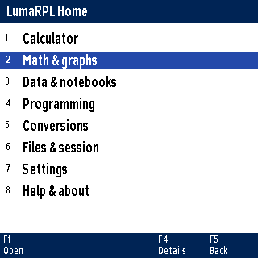
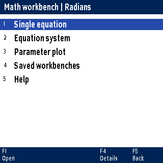
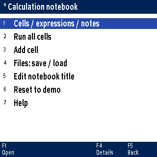

# 1 Welcome to LumaRPL

LumaRPL brings a stack-based scientific calculator, colour graphs and small programming tools to the ClockworkPi PicoCalc. You can do a quick calculation at the stack, open a guided workbench for a larger problem, and keep programs and documents on the SD card.

This guide starts with calculations you can try immediately. Later chapters follow a problem from entering its inputs to checking, plotting and saving its results. The companion Programming Guide covers RPL, Lua, CHIP-8, the source editors and their references.

## Your first calculation

1. Start LumaRPL from the UF2 Loader. The calculator stack opens.
2. Type `2`, press **Enter**, then type `3` and press **+**.
3. The answer appears immediately: **5**. Type `4` and press the multiplication key to use that answer in the next calculation. The result is **20**.

Spaces separate values and commands in the examples. You can also enter the values one at a time. Finish textual RPL commands with Enter. Arithmetic keys can finish an entry immediately: if the result already appears, continue without another Enter. A code box is not a menu path.

> Before experimenting with an existing session, press Ctrl+S to save it. Examples that store a name can replace a variable with that name.

## Find your way around

Press **Ctrl+T** for Home. Move with the arrows and open an item with Enter or F1. F5 or Esc returns. Most tools also show the available function-key actions along the bottom.



| Home category | What you will find |
| Calculator | The stack and calculator soft menus |
| Math & graphs | Graphs, equations, calculus, forms and mathematical workbenches |
| Data & notebooks | Tables, statistics, inference, fitting and notebooks |
| Programming | HOME RPL, source files, Lua, CHIP-8 and sprites |
| Conversions | Units, currency and rate/network choices |
| Files & session | Session saves, document browsers and loader return |
| Settings | Display, calculation, clock, network and device status |
| Help & about | Calculator, command and language references; credits |

Finish a calculator entry with Enter, or cancel it with Esc, before opening a tool that needs the calculator engine.

# 2 Working with the stack

RPL places objects on a stack. The most recently entered object is at level 1, the top of the stack. On the display, new results appear at the bottom. Commands take inputs from there and put their answers back.

## Order matters

Calculator entry:

```rpl
10 3 -
```

The answer is **7**, because subtraction takes the earlier value minus the top value. The same order applies to division: `10 2 /` gives 5. For a power, `2 3 ^` means 2 raised to 3.

| Entry or action | Stack, bottom to top | Why |
| 10 Enter | 10 | First input |
| 3 Enter | 10, 3 | Second input is on top |
| - | 7 | 10 minus 3 |
| DUP Enter | 7, 7 | Copy the top value |
| * | 49 | Multiply the two copies |

## Enter negative numbers

With fewer than two values on the stack, type `-1` and press Enter to enter a negative number. With two or more values and an empty entry, **-** subtracts immediately. To enter a negative number in that case, type `1 Neg` and press Enter; this adds -1 without subtracting the existing values. Subtraction after an entered number retains the usual operator behavior.

## A calculation in stages

To calculate `(3+4)*(5+6)`, complete each parenthesis on the stack:

```rpl
3 4 + 5 6 + *
```

The intermediate stack is `[7,11]`, with 11 on top; multiplication leaves **77**. There is no need to store the intermediate answers in variables.

## Rearrange values without retyping

`DUP` copies the top value. `SWAP` exchanges the top two. `DROP` removes the top value. `OVER` copies the second value to the top. These are useful when you want to reuse an input or correct its order.

For example, enter `10 3 SWAP -`: the subtraction now means 3 minus 10, so the answer is **-7**. `DROP` is a deliberate deletion; save an important session before practising stack manipulation.

The interactive stack tools also provide roll operations. Select the desired row with Tab, then use the labelled function key. The selected row stays active for repeated operations. A roll moves values through the selected stack range; it is easier to understand after trying DUP and SWAP on a short stack of distinct numbers.

## When an input is missing

“Too few arguments” means that a command needed more stack inputs. It does not necessarily indicate a bad number. For `FixedDisplay` or `Fix`, supply a display count first, such as `3 Fix`.

Press Esc to dismiss the error, check the command's Help example, and supply its inputs in the documented order. Viewing Help does not execute the example.

# 3 Numbers, expressions and variables

The stack can hold more than decimal numbers. It also holds exact fractions, complex numbers, arrays, lists, names, text and programs. The notation tells LumaRPL which kind of object you mean.

## Exact and approximate answers

Enter `1 3 /`. In exact arithmetic, the result is the fraction **1/3**. A decimal approximation is a different presentation and may require rounding. Keep exact values when you want fractions or symbolic calculations to remain exact.

For a decimal scientific value, type an exponent such as `1e-6`. In native quantity prompts this can represent one micro-unit when followed by the appropriate unit, for example `1e-6_F`.

## Complex values

A rectangular complex literal can be entered as `(1;2)`, meaning real part 1 and imaginary part 2. Try:

```rpl
(1;2) (3;4) +
```

The result is **4+6i**. The display may typeset the imaginary unit differently from this printed notation. The Complex workbench in chapter 16 offers guided rectangular/polar entry and operations.

For the imaginary unit alone, enter `i`. To calculate its factorial, type `i!` and press Enter; `i Factorial` is equivalent. The result is approximately `0.498015668118-0.154949828302i`. The calculator recognizes `i`, `i!` and `i Factorial` as convenient entries for an unassigned imaginary unit. A stored variable named `i` still takes precedence. RPL program source, iterator names and quoted algebra retain their normal symbol semantics.

`Gamma` accepts complex numbers, for example `(1;1) Gamma` gives the same result as `(0;1)!`. Complex Gamma uses the selected calculation precision and works independently of degree/radian mode. Zero and negative integer arguments are poles and report a domain error. Complex `LnGamma` returns the principal logarithm of Gamma. Complex `Erf` and `Erfc` are also supported. Very demanding inputs can report precision loss when the available precision cannot safely resolve cancellation.

## Mathematical constants and functions

Press **Ctrl+O** at the calculator to open the existing **Math** soft menu. You can also enter `MathMenu`. Choose **Const** for mathematical constants (enable `ShowBuiltinConstants` if the Mathematics category is hidden), **Cmplx** for the imaginary-unit symbol, and **Powers** or **Trig** for functions. Constants inserted through these menus remain distinct from variable names in expressions and programs.

Use Tab to select a soft-menu row, F1-F5 for columns 1-5, and Ctrl+F5 for column 6. Esc goes back. The existing menus keep their normal RPN and algebraic editing behavior; function keys may calculate when used with stack operands. Ctrl+A still opens the complete Command Catalogue for command insertion. Source editors keep their own shortcuts and insertion tools.

## Scientific functions

Functions take their input from the stack. `81 SQRT` gives 9; `1 LN` gives 0; `0 EXP` gives 1. For trigonometry, choose the intended angle mode first: `Deg 30 SIN` gives a result equivalent to 0.5. A decimal/approximate marker may appear with a numerical result.

## Grouped calculator entries

Type `((2^3+4)-2)` and press Enter to get **10**. Entries beginning with parentheses use algebraic grouping and precedence; `(2+3)!` gives **120** and `(2+4)?` gives **21** on Enter. Classic complex literals such as `(1;3)` and `(1 3)` remain complex numbers.

Use Left/Right to move the formula cursor. Cursor navigation updates the editor without clearing the whole display. When the cursor is inside an entry, operator keys insert text instead of calculating. Immediate numeric shortcuts apply at the end of the entry. If a formula has an error, the editor retains your original formula and maps the error cursor back into it; dismiss the error, correct the input, and press Enter again. Quoted algebra and RPL programs keep their existing syntax.

## Triangular sums with Termial

Type `6?` or `6 Termial` and press Enter to sum `1+2+3+4+5+6`, giving **21**. `0?` gives zero. Counts must be nonnegative whole numbers; fractions and negative counts report a domain error. Whole-valued decimals such as `6.0` are accepted. The calculation uses `n*(n+1)/2` and keeps integer results exact, including large counts.

In quoted algebra, `'N?'` means `Termial(N)`, and `'(2+4)?'` gives 21 when evaluated. In RPL, put a space before `?` after a variable (`N ?`), or use `N Termial`. Ordinary RPL names ending in `?` remain valid. Use the explicit name prefix (a circled V) when quoting a literal name that ends in `?`. The explicit undefined constant (a circled C followed by `?`) is unchanged.

With the editor empty, pressing `?` immediately applies Termial to the top stack value: `6 Enter ?` gives **21**. Similarly, `6 Enter !` immediately gives **720**. Typing `6?` or `6!` also calculates immediately, without Enter. In programs and quoted algebra, these characters remain mathematical notation.

Termial is also in the Command Catalogue and at the end of Math > Proba. It follows the same postfix editing convention as factorial.

## Fourier transforms and matrix commands

`FFT` and `InvFFT` now work directly on the calculator stack and in RPL programs.
Enter a real or complex vector with a power-of-two length from 1 to 1024, subject
to available memory. `FFT` returns all frequency coefficients in their ordinary
order, with a negative exponential and no scaling. `InvFFT` uses the positive
exponential and divides by the vector length. Neither command applies a window
or subtracts a mean. The Signal analysis workbench still provides those options.

```rpl
[1 2 3 4] FFT InvFFT
```

The Matrix menu includes decimal `MatrixQR`, `LQ`, `Cholesky`, `SVD`, `SVL`, `CondNum`,
`Schur`, `SpecRad`, `ToDiagonal` and `FromDiagonal` commands. Factorizations accept
real matrices with dimensions up to 32, subject to memory. QR returns Q then R;
LQ returns L then Q; Cholesky returns a lower triangular factor. SVD returns U,
a vector of descending singular values, then V, with A = U diag(s) transpose(V).
Schur returns Q then T, with A = Q T transpose(Q). Schur can retain two-by-two
blocks for complex eigenvalue pairs. Singular condition numbers report divide
by zero; invalid or nonconvergent factorizations report an error.

`RREFMOD` performs exact modular row reduction. Select a prime with
`5 CASModulus`, for example; the default modulus is 13. Non-integer matrix
entries and composite moduli are rejected.

## Probability and symbolic commands

The Probability menu now includes lower-tail probabilities and finite inverse
probabilities. `Normal` takes mean, variance and x; `Student` and `ChiSquare`
take degrees of freedom and x; `FDistribution` takes numerator degrees of freedom,
denominator degrees of freedom and x. Their `Inv` commands use a lower-tail
probability strictly between zero and one in place of x. Existing `UTPN`, `UTPT`,
`UTPC` and `UTPF` commands remain available for upper tails.

`Taylor` takes expression, variable, expansion point and nonnegative order.
`FiniteDifference` takes expression, variable and step, and returns the forward difference.
`DerivX` and `IntVX` use the currently selected algebra variable. Taylor and
analytic Limit coefficient calculations use radians and preserve your angle
mode. `Limit` takes expression, variable and a finite real point; it handles
continuous analytic expressions and removable zero-over-zero singularities.
Discontinuous or unsupported limits report an error rather than an estimate.

Trigonometric and exponential rewrite commands are available in their calculator
menus. `LnCollect` conservatively combines logarithms of positive integer
factors, preserving complex logarithm branches. `SinCos` rewrites sine and cosine
using complex exponentials; use `ToDecimal` or `NumericalConstants` to evaluate
the imaginary constant. `Find` returns the first one-based match in a list or
vector, or zero when absent.

The **Alarms** menu under Time or Date manages clock-based reminders. Set the
local clock first. Enter `20261225.093000 "Check the oven"` and choose **→Alarm**
(`StoAlarm`) to schedule a reminder and receive its ID. **Alarms** lists records;
**Alarm→** recalls an ID; **DelAlm** deletes an ID. **Ack** dismisses the oldest
due reminder; **AckAll** dismisses all due reminders and preserves future ones.

A due reminder displays at an idle boundary; press Enter to acknowledge it.
Alerts wait for programs and INPUT prompts. Save the session to retain alarms
across restarts. Up to 32 records, including acknowledged ones, are retained.
The device cannot alert while switched off; overdue reminders appear after
restoring the session with the correct clock. Recurring alarms and hardware
wake-up are not supported.

PicoCalc menus omit inherited unavailable actions, including IR printing,
legacy file-handle commands and unimplemented branch labels.
Use the existing file browser, RPL structured control flow and subprograms, or
Lua file APIs for those supported workflows. No IR or other hardware integration
has been added. Range-to-standard-deviation conversion remains deliberately
rejected: an interval alone does not specify a probability distribution.

## Quoted algebra

Single quotes preserve an algebraic expression. Enter `'X^2+1'` to place the expression on the stack. It is different from an RPL program: a program contains a sequence of stack operations inside `«` and `»`.

A native formula field already knows that it contains a formula. There, enter `X^2+1` without surrounding quotes. Some fields accept an equation such as `COS(X)=X`; graph function fields expect just the function, such as `X^2`.

## Store and recall a value

Calculator entry:

```rpl
42 'ANSWER' STO
```

The quoted name is the destination. Enter `ANSWER` to recall the value. With programs, evaluating a stored name runs its program; quoting the name preserves the name itself.

HOME variables and programs are part of the calculator session. **Ctrl+S** saves them. Saving an SD source file does not also save the session, and saving the session does not save every native document.

## Lists and matrices

`{1 2 3}` is a list; `[1 2 3]` is a vector. This two-row matrix example
returns the determinant **-2**. The Matrix workbench also provides a grid editor
and named A/B matrices.

```rpl
[[1 2][3 4]] DET
```


# 4 Calculator menus and settings

Native lists and calculator soft menus have different controls. Recognizing which one is on screen makes settings much easier to use.

## Native lists

Use Arrows and Enter, or the numbered visible row shortcuts 1-8. Left/Right pages through a longer list. In ordinary lists, labelled Previous/Next actions may also be available. F4 Details explains the current choice; F5 or Esc returns.

## Calculator soft menus

When you go back from a submenu, the parent page and Tab-selected row are restored. Opening a fresh root menu starts at its first row.

These have six columns and multiple rows. **Tab** selects a row. **F1-F5** activate columns 1-5 of that row; **Ctrl+F5** activates column 6. The row remains selected until you press Tab again. A genuinely different menu begins at its first row.

Esc returns one calculator-menu level. At the top level, Esc closes the menu. If an error is showing, the first Esc dismisses the error.

## Angles, including n times pi

**Ctrl+R** opens Advanced RPL settings. Open Angles and choose Deg, Rad, Grads or the pi-radian option. A selected angle mode stays selected until you choose another; pressing Grads again does not turn angle measurement off.

| Mode | A right angle | Use |
| Degrees | 90 | Everyday angles |
| Radians | pi/2 | Calculus and most mathematical formulas |
| Grads | 100 | A full turn is 400 grads |
| Pi radians, shown as n times pi | 0.5 | The entered number multiplies pi radians |

Use radians for the trigonometric calculus examples in these guides. Some advanced numerical tools use their own scoped radian setting, as described in their Help.

## Display digits and calculation precision

`3 Fix` requests three places after the decimal point. `16 Precision` requests 16 significant digits for decimal calculations. Display formatting changes how a value is shown; precision affects the calculation itself.

A display-setting key that needs a count uses a value already on the stack. If Fix reports too few arguments, put a count there first. A Beep key toggles a flag, while angle keys select one of several alternatives.

## Modes, Reset and System

The Modes route opens calculator settings. The settings-to-program action, shown as an arrow-to-program entry, creates an RPL program representing settings. Entering that program on the stack does not apply it until it is evaluated with EVAL.

Reset deliberately restores settings; use it only when you want defaults. System opens PicoCalc settings. Save the session with Ctrl+S to keep calculator settings through a restart.

The physical Shift, Ctrl and Alt keys also serve the PicoCalc keyboard. RPL commands such as UILeftShift, UIRightShift and UIAlpha represent calculator UI state; they are not alternate spellings for the source editor's selection and text controls. Use the on-device command description when writing a program that changes UI state.

# 5 Save your work and recover it

LumaRPL has a calculator session and several document types. Treat them as separate notebooks on the same desk: saving one does not save every other one.

## The calculator session

Ctrl+S saves the stack, HOME variables/programs and calculator settings. Ctrl+L loads a saved session, replacing the current calculator state. Save work you want to keep before loading another state.

Ctrl+Q saves and returns to the loader. It checks for unsaved documents and offers the relevant save choices. Cancel, or a failed required save, leaves LumaRPL open.

## Native documents

Graph scenes, workbenches, data tables, formula forms, notebooks, matrices and source files have their own Save actions. A star marks unsaved changes where shown. Source editors use F1 Save. Other tools normally provide Files or Files / help.

| Work | Where to save it |
| Stack, HOME names and settings | Ctrl+S, calculator session |
| RPL / Lua / assembly source | F1 in its editor |
| Graphs and workbenches | Their Files or saved-document menu |
| X,Y observations | Data / statistics, CSV save |
| Notebook | Notebook Files menu |
| Advanced connected study | Save / open / name / notes in the study |
| Colour drawing | Sprite editor F1, .sprite document |

All application data belongs under `/db48x/`. Other applications on the SD card remain separate. Do not remove the card while a save or network-cache write is in progress.

## A failed save

Keep LumaRPL running. The working document remains available in memory. Check that SD is available, then try again, possibly with a new name. Transactional document saves preserve a previous valid file and can recover a backup.

RAM and PSRAM are both volatile. Navigating away can retain a working document during the session; restarting without an SD save cannot preserve that volatile copy.

## A practical restart check

1. Save a native document under a distinctive test name.
2. Change a harmless input, then reopen the saved document. Check the earlier input returns.
3. Save the calculator session if it contains names or settings you want to keep.
4. Return cleanly to the loader, restart LumaRPL, and load the document again.
5. Explicitly rerun a saved notebook or study calculation. Loading it does not execute its formulas.

# 6 Units and number bases

## Convert a physical quantity

Press **Ctrl+U > Unit conversion**. Set Value, From and To, then choose Convert. Try 100 centimetres to metres: the result is **1 metre**. F1 on the result copies it to the stack.

At the calculator you can also use unit syntax:

```rpl
100_cm 1_m Convert
```

Unit spellings are case-sensitive. The underscore attaches a unit to a magnitude. Dimensions must be compatible: a length cannot be converted into a mass. Absolute temperature and a temperature difference require different treatment; use the appropriate quantity rather than substituting a scale name blindly.

## Convert an integer between bases

From the stack, enter `#FFD2h`, then press Enter. `Bin`, `Oct`, `Dec` and `Hex` change its displayed base.

| Command | Digits for the same value |
| Bin | 1111111111010010 |
| Oct | 177722 |
| Dec | 65490 |
| Hex | FFD2 |

The display may add a base marker and digit grouping. The integer's value is unchanged. This works with explicit binary, octal and decimal inputs too: `#101010b` is binary 42, `#377o` is octal 255, and `#255d` is decimal 255.

On this LumaRPL build, ordinary decimal integers work directly: enter `255`, then `Hex` to see FF, or `Bin` for 11111111. You do not need to insert RealToBinary first. Decimal fractions are not converted by this shortcut. BinaryToReal returns a based object to an ordinary integer.

## The Bases menu

Ctrl+Y opens Bases. Tab to the row labelled Base, Bin, Oct, Dec and Hex. F2 is Bin, F3 Oct, F4 Dec and F5 Hex. Base itself takes a radix from 2 to 36. WordSize controls fixed-width bit operations; changing the displayed base does not truncate an integer.

Inside a source editor, Ctrl+Y means Redo. Shortcuts belong to the screen you are using.

# 7 Draw and explore a 2D graph

Press **Ctrl+G > 2D functions**. The function list is the starting point for entering and comparing ordinary Y functions.

## Your first curve

1. Edit Y1 and enter `X^2`, without `Y=`.
2. Use Check to validate the formula, or Preview to inspect its mathematical layout.
3. Set a window that includes X from -3 to 3 and Y from -1 to 9.
4. Choose Plot / trace curves.

The parabola opens upward and passes through the origin. If the plot is blank, check the window, whether the curve is enabled, and whether its formula has finite values in that window.

## Trace, pan and zoom

| In the 2D viewer | Action |
| Arrows | Move the trace point; select curves where offered |
| F1 | Open the sampled-point table |
| F3 | Explore, analysis and export choices |
| F4 | Switch between tracing and panning |
| + / - | Zoom |
| Esc | Interrupt sampling or return from the viewer |

Read the bottom labels in specialized views: an implicit plot, path plot or surface has its own relevant actions. The unified native renderer gives the views a consistent appearance while retaining controls appropriate to each graph type.

## Compare two functions

Keep Y1=`X^2` and set another enabled curve to `X+2`. Plot both. The crossings are at X=-1 and X=2, giving points (-1,1) and (2,4). You will use those curves for intersection and area calculations in chapter 8.

## Save the graph

Use the graph's file menu to save its scene. The scene keeps inputs and viewing settings. Saving a session is a separate operation. A numerical graph is a sampled picture: very narrow features, singularities and rapid oscillations deserve a closer window and an independent calculation.

# 8 Analyze a graph

Graph analysis turns a visual question into a numerical calculation. Open the viewer's F3 exploration/analysis choices and select the operation you need.

## Roots and intersections

For a root, select a curve and choose bounds that surround the feature. For two intersections, select the two curves and a suitable interval. With `X^2` and `X+2`, search near -1 or 2 separately to confirm each crossing.

A reported root is a solution resolved by that search. An interval search does not prove it found every root. A tangent contact, a discontinuity or a narrow feature can need a more suitable interval or a different method.

## Minima, maxima and tangents

On `X^2`, a local minimum is at X=0, Y=0. Select an interval around zero for an extremum search. For a tangent at X=1, the expected slope is 2; the line is `Y=2*X-1`.

A tangent is local information at the chosen point. A cusp or discontinuity may not have a well-defined derivative. Read a convergence/domain message before treating a numerical slope as a result.

## Select integration bounds visually

Use the analysis control to mark a first and second bound on the graph, then confirm them. Move the trace point before marking each end. Numeric bound entry is available when you need precise endpoints.

For `X^2` from 0 to 1, the signed integral is **1/3**. A signed integral can cancel contributions above and below the axis. Geometric area adds positive contributions instead.

## Area between curves

For the curves `X+2` and `X^2`, use X=-1 to 2. The line is above the parabola throughout that interval. The area is:

```text
integral from -1 to 2 of (X+2-X^2) dX = 4.5
```

Use the area-between-curves action rather than reading an arbitrary shaded pixel count. At crossings inside a longer interval, the relative order of the curves can change.

## Export a useful record

Export saves SVG artwork or sampled CSV data under `/db48x/exports/`, as offered by the current view. SVG preserves a graph as scalable artwork; CSV preserves numerical samples. Neither is a substitute for saving the editable graph scene.

# 9 Parametric, polar, surface and implicit plots

## A parametric circle

Open **Graphs > Parametric / polar**. Choose parametric entry with `X(T)=COS(T)` and `Y(T)=SIN(T)`. Set T from 0 to approximately 6.283185307 in radians. The path is a unit circle.

The parameter range matters as much as the X,Y window. A short T interval draws only part of the path. A polar plot instead uses `r(T)`; `r(T)=1` over a full turn also draws a unit circle.

## Shade an inequality region

Choose **Ctrl+G > Inequalities**. Set one boundary to Y>=X^2 and another to Y<=X+2, then plot their intersection. The region lies between the curves from X=-1 to X=2. Inclusive boundaries are solid; strict inequalities use dashed boundaries.

A blank region can mean no overlap, the wrong window or undefined values. The shading is a finite-resolution picture; use tracing and numerical analysis to inspect its boundaries.

## A 3D surface

Choose **Graphs > 3D surfaces**. Enter `X^2-Y^2` over X,Y from -3 to 3. The result is a saddle. Arrows rotate; +/- zooms; F1 resets the camera. Use the labelled Export action for a saved image where available.

Rotation changes the view, not the mathematical function. A surface with undefined samples can contain holes. Check the formula's domain and bounds if the whole surface is unavailable.

## An implicit circle and contours

Open **Math & graphs > More: complex / applied math > Advanced studies > Implicit graphs / optimization**. Enter `X^2+Y^2=25`, set both window axes to -8..8, and plot at residual level zero. The circle has radius 5.

For a field `X^2+Y^2`, contour levels 1, 4 and 9 draw circles of radii 1, 2 and 3. Up to three levels are supported. An equation is converted to a residual; zero means its left and right sides agree.

In this view, arrows probe X,Y; Enter shows the field/residual. F1 copies X,Y, F2 changes the active level, F3 exports SVG, and F4 changes to pan. The crosshair does not snap to a contour.

Implicit plots use an 81 by 81 grid, bounded evaluation work and a bounded segment cache. Sub-cell features can be missed. Esc interrupts sampling. Save a `.study` document for the advanced-study inputs.

# 10 Equations, systems and parameters

**Ctrl+W** opens Math workbench. Its starting choices include Single equation, Equation system, Parameter plot and saved workbenches.



## Solve COS(X)=X

1. Select radians in calculation settings.
2. Open Single equation and enter `COS(X)=X`.
3. Use an initial guess of 1 and choose the local numerical solution.
4. Expect X approximately **0.7390851332**.

You can enter a plain expression as well; it is interpreted as equal to zero. A local solution uses a starting guess. Interval search uses lower and upper bounds through the native root-analysis engine. Change the guess or interval when a domain/convergence failure is reported.

## Solve two simultaneous equations

Enter `X+Y=3` and `X-Y=1` in the two-equation system. Supply guesses for X and Y, then solve. Expect **X=2, Y=1**. The residual for each equation should be near zero.

Three-equation systems use X,Y,Z. Try `X+Y+Z=6`, `X-Y=0`, `Z=2`: X=2, Y=2, Z=2. Singular, inconsistent or poorly initialized systems can fail; a displayed numerical answer should be judged with its residuals.

## Symbolic isolation

Symbolic isolate is a separate action. It preserves exact expressions for supported rearrangements and reports unsupported cases explicitly. It does not silently replace an unsupported symbolic problem with a numerical answer.

## Adjust a parameter plot

Start with `A*SIN(B*X+C)` and A=1, B=1, C=0. Define each parameter's range and positive step. In the plot, choose **F3 Explore > Parameters**. Up/Down selects A, B or C; Left/Right adjusts it; Enter accepts a typed value; Esc returns to tracing.

Parameter values belong to the workbench. Adjusting them does not overwrite shared calculator variables. Use Store parameters only when you deliberately want that change.

## Keep results deliberately

Viewing or cancelling a solve preserves the calculator's stack and variables. Choose Copy to stack or Store variables explicitly. Saved `.workbench` documents keep equations, guesses, parameter settings, angle mode and the graph scene; results are recalculated when requested.

# 11 Calculus and symbolic algebra

Open **Home > Math & graphs > Calculus & algebra**. The main routes are Calculus in X, Multivariable calculus, Symbolic algebra, Value / approximation and Guided polynomials.

## Differentiate and integrate in X

For `X^2`, the derivative is **2*X** and an antiderivative is **X^3/3**. An indefinite antiderivative represents a family: add a constant when using it in mathematics. A definite integral from 0 to 1 is **1/3**.

Use radians for trigonometric differentiation and integration. `SIN(X)` has derivative `COS(X)` in that convention. A numerical value at one point and a symbolic expression are different results; choose the action that answers your question.

## Expand, simplify and substitute

In Symbolic algebra enter `(X+1)^2` and choose Expand. Expect an expression equivalent to `X^2+2*X+1`. Substituting X=2 gives 9 without storing X in shared calculator variables.

Collect/factor and partial fractions use supported upstream rules. A failure on a difficult expression is not permission to assume an unshown result. Copy a long result to the stack if it exceeds the native formula field's 159-byte limit.

## More than one variable

For `F(X,Y)=X^2+Y^2`, the gradient is `[2*X,2*Y]` and Hessian is `[[2,0],[0,2]]`. Add `G(X,Y)=X*Y` for a Jacobian with rows `[2*X,2*Y]` and `[Y,X]`.

At (1,1), F is 2 and the tangent plane is `Z=2*X+2*Y-2`. The unit-square double integral of F is 2/3. The tangent and numerical integral use finite sampling and refinement; the reported refinement estimate is not a rigorous bound on every possible function.

## Guided polynomials

Enter coefficients highest power first. For `X^2-1`, degree 2 with coefficients 1,0,-1 gives roots -1 and 1. `X^2+1` gives complex roots. With B=`X-1`, dividing A=`X^2-1` by B gives quotient X+1 and zero remainder.

The guided solver supports degrees 1-8 and nonzero leading coefficients. Repeated roots carry multiplicity; general roots may be approximate or fail to converge. Check a root by evaluating the polynomial near it.

# 12 Data, statistics and fitted curves

Press **Ctrl+D** for Data / statistics. The working table has X,Y pairs. Enter observations directly or import CSV; save the table separately from the calculator session.

## Fit a straight line

Enter three rows: (0,1), (1,3), (2,5). Choose a linear regression. Expect intercept 1 and slope 2, giving **Y=1+2*X**. Plot the points and fitted curve together, then examine residuals.

Residuals are observed Y minus the fitted prediction. Small residuals on a small example do not establish that a model is appropriate for future data. Keep the physical meaning and units of X,Y with the observations.

## Import and export

CSV observations belong under `/db48x/datasets/`. The format has exactly two numeric columns, X then Y, separated by a comma. An optional first line can be `X,Y`. Use a decimal point; missing or non-finite values are rejected.

```text
X,Y
0,1
1,3
2,5
```

Choose CSV files > Load / import CSV and select the file. Check the displayed rows after importing. Export makes a portable numerical table; it does not preserve every workbench setting.

The bounded native data table holds up to 128 rows. Operations report unsupported sizes rather than silently using an arbitrary subset, except where a tool explicitly describes segment handling.

## Interpolate within observations

Open Interpolation / curve fitting. Linear interpolation joins samples. Shape-preserving cubic interpolation, PCHIP, is useful when monotone data should remain monotone. X must be strictly increasing and distinct, with at least two samples.

Evaluate inside the sampled range. There is no automatic extrapolation. A smooth interpolated curve still reflects the resolution and quality of the supplied observations.

## Fit a nonlinear model

The exponential demo creates `Y=2*EXP(0.5*X)+1` after confirmation. Choose the model `A*EXP(B*X)+C` and guesses near A=1, B=0.2, C=0.3. A successful fit should find values near 2, 0.5 and 1, with small residuals.

This is local, unweighted least squares with three identifiable parameters and at least four rows. Initial guesses and the model's domain matter. Settings save in `.science`; save the underlying CSV table separately.

# 13 Probability and inference

Open Probability from **Math & graphs**, or from **Data & notebooks**. Distribution calculations and inference from observations answer different questions.

## A normal probability

Choose normal with mean 0 and standard deviation 1. Set interval -1 to 1. The interval probability is approximately **0.6826894921**. The density at zero is approximately 0.3989422804; a density is not the probability of one exact continuous value.

For a discrete example, binomial n=10, p=0.5 gives P(X=5)=**0.24609375**. Discrete interval endpoints include both integers. The inverse CDF returns the smallest qualifying integer for discrete distributions.

## Infer a mean from data

Enter X observations 1,2,3,4,5 in the table, then open Inference / distributions. Select X. Its mean is 3 and sample standard deviation is sqrt(2.5). A 95% Student t interval is approximately **1.03676 to 4.96324**. With null mean 3, the two-sided statistic is 0 and p-value is 1.

This calculation assumes independent observations and suitable population/sample conditions. Paired differences require independent pairs and suitable differences. A p-value is not the probability that the null hypothesis is true.

For proportions, enter successes and trials. Wilson intervals remain bounded between zero and one; the score test is an approximation with sample conditions. Enter confidence as a fraction, such as 0.95.

## Additional distributions and tests

Advanced studies > Statistics / uncertainty offers uniform, exponential, Student t and chi-square choices, plus an exact binomial test. Student t with five degrees of freedom has CDF(0)=0.5. For k=0, n=10, p=0.5, the probability-ordering two-sided exact binomial p-value is 0.001953125.

Weighted fitting and Welch's comparison use captured study tables. Read their assumptions and unit labels before copying results. A saved inference configuration does not also save the separate main data table.

# 14 Formula forms and notebooks

## Make a reusable form

Press **Ctrl+F**. A formula form keeps a formula and named inputs so you can repeat a calculation without retyping its structure. Inputs and the chosen result unit can carry physical units.

For a simple electrical calculation use `V/I`, with V=12_V and I=4_A, and choose ohms as the result unit. The answer is **3 ohms**. Change one input and calculate again. Graph an input sweep varies one named input while the remaining inputs stay at their defined values.

Use the form's Save action to keep the formula, named inputs and values. A form is useful for a recurring calculation; RPL is useful for a sequence of operations and decisions.

## Build a calculation notebook

Press **Ctrl+N**. Create three expression cells:

```text
2+3
R1^2
R2/3
```

Choose Run all. The results are 5, 25 and, with exact arithmetic, 25/3. R1 means the result of cell 1. References must point to earlier cells.



## Decide when to rerun

Editing or loading a notebook does not run it. Use Run all or Run through a cell. Notes are text and never execute. After moving or deleting cells, check numbered references before rerunning.

Notebook files keep expressions and notes; results are transient and are refreshed on request. Save the notebook through its Files menu, independently of the calculator session.

# 15 Matrices and vectors

## Enter a matrix in the grid

Open **Math & graphs > Matrices & vectors > Matrix workbench**. Edit matrix A, choose its size, then edit cells. The grid has its own labelled actions; use F1 Edit and the displayed size/result/save choices rather than assuming every screen uses a source editor's F keys.

For A=`[[1,2],[3,4]]`, determinant is -2. Its inverse is `[[-2,1],[1.5,-0.5]]`. Enter matrix B as the identity to verify A*B=A.

## Calculate with A and B

Matrix arithmetic provides A+B, A-B, A*B and A/B, where division means A times inverse(B). Dimensions must agree with the operation. Scalar arithmetic uses a separate scalar k. Swap A and B deliberately exchanges them.

Matrix operations include determinant, transpose, inverse and solving supported systems. Powers and row reduction are available through their own route. A singular inverse reports failure rather than a useful inverse.

Named matrix registers live in HOME; save the calculator session to retain them. A/B matrix documents save through their matrix file menus.

## Vector geometry

Choose Vector workbench. Try A=[1,0,0], B=[0,1,0]. Dot product is 0; cross product is [0,0,1]; angle is 90 degrees. In two dimensions, cross returns the signed Z component.

Arithmetic supports vector addition/subtraction, scaling, division by a scalar and a unit vector. Projection onto a zero vector and angles involving a zero vector are undefined. Use compatible physical units when components represent quantities.

Plot vectors uses a 2D projection. For 3D vectors, choose XY, XZ or YZ; it is a coordinate projection rather than a new 3D surface. Files / help saves the shared `.mathlab` workbenches.

## Numerical decompositions

Advanced studies > Advanced linear algebra imports a square real dimensionless matrix up to 6 by 6 from matrix A after confirmation. For `[[3,1],[1,3]]`, singular values are 4 and 2, condition number 2, and symmetric eigenvalues 2 and 4.

QR reconstructs A=Q*R. SVD reconstructs A=U*diag(s)*V-transpose. Eigenvectors are columns; their signs may differ. Rank and least-squares results depend on a numerical singular-value threshold. The original exact and unit-aware matrix arithmetic remains available separately.

# 16 Complex numbers and interactive geometry

## Use the Complex workbench

Open **Math & graphs > More: complex / applied math > Complex workbench**. Enter a value in rectangular or polar form. A number with rectangular components 3 and 4 has magnitude 5 and phase approximately 53.130102 degrees, or 0.927295218 radians.

Keep angle units clear when switching representations. Compatible physical quantities can be used for real/imaginary components or polar magnitude. An explicit phase quantity describes an angle.

Use the displayed arithmetic and function choices, then Copy when you want the answer on the stack. Store or replace a workbench value deliberately; simply reading a result does not imply that action.

## Explore a construction

Open **Ctrl+G > Interactive geometry**. Create or open a construction with named points. Move a selected point using the view's controls and inspect lengths, angles or other offered measurements.

A right triangle with points (0,0), (3,0), (3,4) has side lengths 3,4,5. Moving a point changes the construction; save its geometry document if you want those new coordinates after restart.

Geometry can declare coordinate units and rescale a saved construction. Changing units should reflect the intended physical construction, not merely relabel unrelated magnitudes. Use the common graph's zoom/pan and export actions where offered.

# 17 Differential equations

Choose the differential-equation route from Graphs. A direction field shows the local slope; a numerical trajectory follows a chosen initial condition. Neither alone establishes a general symbolic solution.

## Start with one equation

For a simple growth/decay example use `Y'=Y` with Y(0)=1. At X=1 the exact solution is e, approximately 2.718281828. Choose a finite X interval and inspect the curve and sample table.

A direction field helps you see how nearby initial conditions behave. Singular slopes, discontinuities or a poor window can make a trajectory unavailable. Esc interrupts sampling; do not treat a failed or partial numerical integration as a complete solution.

## Coupled and second-order equations

In coupled mode enter `Y'=F(X,Y,Z)` and `Z'=G(X,Y,Z)`. In second-order mode enter `Y''=G(X,Y,Z)`, where Z means Y'; the solver supplies Y'=Z automatically.

Try F=Z, G=-Y, initial X=0, Y=1, Z=0, final X approximately 6.283185307. Y follows COS(X), Z follows -SIN(X). The phase portrait is a circle. Second-order G=-Y gives the same solution.

## Numerical scale and units

The coupled solver uses adaptive RK4 step doubling with a relative/absolute scale of 1e-7 and at most 8192 right-hand-side evaluations. These are bounded numerical estimates for non-stiff problems. Stiff or singular equations may fail.

Declare X,Y,Z units consistently. For a second-order equation, Z must have the dimensions Y/X. Derivatives must match their declared dimensions. Use absolute kelvin rather than affine temperature quantities in these numerical models.

Save equation inputs through the relevant ODE or advanced-workbench file menu; export sampled data separately when needed.

# 18 Finance and engineering

## Keep rate conventions visible

Open **Math & graphs > Finance / engineering > Financial calculator**. Set principal, nominal annual rate in percent, number of periods and periods per year. Choose beginning/end-of-period payments deliberately. A cash-flow discount rate is per cash-flow period, which is a different field from a nominal annual rate.

For compound growth, principal 1000 at 5% annually for two annual periods gives **1102.50**, before taxes, fees or additional flows. Verify period conventions before interpreting a loan, deposit or rate/term calculation.

## Cash flows and expanded tools

Enter dated-period cash flows in the offered order, keeping the initial outlay negative and receipts positive when that is the model's sign convention. NPV discounts each flow at the specified per-period rate. For flows -1000,600,600 and 10% per period, the mathematical NPV is approximately **41.322314**.

An IRR is a rate making NPV zero. Multiple sign changes can produce multiple roots or no suitable root; a local numerical result is not a guarantee of a unique economic rate. Use the exact input labels and Help for each finance action.

Growth / rate / term offers Compound future value, Savings with regular deposits, Solve nominal annual rate and Solve payment count. Amortization reports remaining balance and cumulative principal/interest after a chosen count; Cash flows / NPV offers NPV and an interval IRR search. Save finance inputs through their Files menu, then verify the saved timing and frequency settings when reopening them.

## Ideal RLC circuits

Choose Engineering: RLC / RC filters. Quantity prompts accept compatible units and convert to SI. A 1 microfarad capacitor can be entered as `1e-6_F`.

Series impedance is `R+j*(2*pi*f*L-1/(2*pi*f*C))`. Parallel impedance combines admittances. Ideal zero resistors or inductors can short an ideal parallel network; interpret ideal limits accordingly.

## An RC cutoff example

Set R=1000 ohms, C=1e-6 farads and f approximately 159.1549431 Hz. Low-pass and high-pass magnitudes at this frequency are approximately **0.70710678**, or -3.0103 dB. Low-pass phase is -45 degrees; high-pass phase is +45 degrees.

A Bode graph uses X=log10(frequency in Hz), so X=3 means 1000 Hz. Enter positive sweep frequencies. Inductance is not used for an RC filter. These models describe ideal components, not parasitics or a measured circuit.

# 19 Measurements, integers and signals

## Carry units through a model

Open Units and dimensions for a one-off dimensional calculation. `(12_V)/(4_ohm)` converted to amperes is **3 A**; `(2_m)+(30_cm)` converted to centimetres is **230 cm**.

Data-unit declarations label existing numerical magnitudes; they do not rescale all observations automatically. Keep declarations with the matching data. Probabilities, percentages and integer operations remain dimensionless.

## Propagate independent uncertainty

Open Measurement uncertainty. Enter F=`A*B`, A=2_m with standard uncertainty 0.1_m, B=3_m with 0.2_m, and C=0 with zero uncertainty. The nominal area is **6 m^2**, with independent first-order standard uncertainty **0.5 m^2**.

The method combines squared sensitivity contributions and assumes independence. It is not a confidence interval. Large uncertainties, nonlinear behaviour or a cusp can invalidate the approximation. Advanced studies offers correlated uncertainty and Monte Carlo when those are the intended models.

## Integer calculations and recurrences

Discrete mathematics provides GCD, LCM, modular powers, factorization and bounded recurrences. For A=12 and B=18, GCD=6 and LCM=36. A recurrence `F(N,U)=2*U+1`, starting U=1 at N=0, gives 1,3,7,15,31,63 for six rows.

The recurrence is numerical and bounded to 128 rows; it is not an arbitrary-size exact sequence engine. A failed/cancelled generation does not replace the table with incomplete data.

## FFT and filtering

Signal analysis accepts exactly 8,16,32,64 or 128 finite, uniformly sampled Y values. Set a sample rate in hertz, or infer it from uniformly increasing X times. No arbitrary tail is silently discarded.

The sine demo has 32 samples at 128 Hz of a unit-amplitude 16 Hz sine. With a rectangular window and mean removal, expect a 16 Hz peak of amplitude 1 and bin spacing 4 Hz. Hann/Hamming windows reduce leakage but spread a tone across bins.

This one-sided FFT scale describes peak amplitude. Welch PSD in Advanced studies instead describes density in Y^2/Hz. Mean removal, window and sample rate are part of the interpretation; save them along with the correct table.

# 20 Connected studies and advanced numerical work

Open **Math & graphs > More: complex / applied math > Advanced studies**. The study connects two captured tables, equations, a numerical matrix and settings in one saved `.study` document.

## Capture and compare data

First enter/import observations in Data / statistics and declare units. In Connected study / data choose Capture current data as A. Capture another set as B when needed. Each capture asks before replacing the study table; the original main table remains available.

Use Send A/B to Data / statistics only when you intend to replace the main table. Separate X/Y units travel with each captured table. Compatible B units can be converted into A units for the Welch comparison.

## A bounded local optimum

In Implicit graphs / optimization choose objective `(X-1)^2+(Y+2)^2`, bounds -5..5 on each axis, initial point (0,0), and Local minimum. Expect (1,-2), F near zero.

This is a local numerical, box-constrained search. Rectangular bounds are the constraints in this release. Different initial points can give different answers on a multi-basin objective. Step resolution reached does not establish a global optimum.

## Limits, series and improper integrals

For `SIN(X)/X` at zero, a two-sided numerical limit should stabilize near 1. `1/X` has no finite two-sided limit there and should remain unresolved. Numerical nearby samples are evidence, not a symbolic proof.

A degree-four Taylor model for EXP(X) at zero has ascending coefficients 1,1,0.5,1/6,1/24. Supported symbolic derivatives are evaluated numerically; no general remainder bound is supplied.

For EXP(-X) from 0 to positive infinity, an improper-integral estimate should be near 1. Singularities and oscillations can defeat the bounded refinement. Read an unresolved result as unresolved.

## Correlated uncertainty

For the chapter-19 area example, correlation AB=0.5 and AC=BC=0 gives first-order standard uncertainty approximately **0.608276253 m^2** at nominal 6 m^2. The correlation matrix must be positive definite; perfect correlations are outside this implementation.

Monte Carlo uses correlated Gaussian measurements and a saved seed. Repeating seed and settings repeats the draws. A central 95% percentile interval has simulation error and is not a fitted-parameter confidence interval. A draw outside the model domain stops the run.

## Signals and control systems

Convolution and cross-correlation use captured A/B signals, with complete output length bounded by 128 rows. Welch PSD uses 32/64-sample Hann segments, 50% overlap and mean removal. A final incomplete segment is omitted and its unused row count is disclosed.

For H(s)=1/(s+1), enter numerator [1] and denominator [1,1], highest power first. The pole is -1. At 1/(2*pi) Hz the gain is about -3.0103 dB and phase -45 degrees. A unit-step response at five seconds is about 0.993262053.

Transfer degrees are at most three. Time responses require strictly proper functions and compare two RK4 resolutions; fast, stiff or unstable cases can remain unresolved. Save the study inputs; displayed results are recalculated only when requested.

# 21 Currency, Wi-Fi and the clock

## Convert with a cached rate table

Press **Ctrl+U > Currency conversion**. Set Amount, From and To, then Convert. From/To persist automatically when SD saving succeeds. Swap reverses the pair. The result includes a rate observation date; check it before using the value.

Rates are reference observations from Frankfurter, not a promise of a bank's transaction price. Fees and spreads are not included. The calculation uses `amount * target_rate / source_rate`, with cached rates quoted per EUR.

## Refresh without restarting

Currency conversion > Refresh connects, obtains current time and downloads rates over HTTPS. Validated rates become active immediately. They are then saved for offline use.

A failed download retains the old active table. If saving fails after a successful download, new rates still work for the current session, while the previous valid disk cache is retained. Saving manually edited/imported rates is a separate choice in rate management.

## Configure a network

Use Settings > Network, or the Wi-Fi setup choice under Conversions. Enter the exact SSID and password. Pico 2 W uses a 2.4 GHz network; the current connection UI supports WPA2 personal/AES and genuinely open networks. WPA3-only or enterprise configurations are outside this setup.

Saved credentials enable quiet, nonblocking startup time synchronization. That startup task does **not** download currency rates; use Refresh for that. A weak signal or a single rejected join can be transient: move closer and retry before changing correct credentials.

Radio / connection reports current connection and radio state. Details contains attempt/retry information. A radio being off after a transaction can be normal; the application releases it after use.

## Timezone and historical dates

Settings > Clock / timezone chooses displayed local time. Toronto/Eastern is the default and follows daylight saving. Custom fixed offsets do not. The clock needs a new synchronization after restart.

Manual UTC is a fallback when NTP is unavailable. Enter current UTC, not local time. A historical rate date requests past observations and does not backdate the clock or TLS. Weekends/holidays can yield an earlier observation date.

Credentials and their recovery files on SD are readable. Forget removes stored credentials/recovery copies. NTP is unauthenticated; HTTPS still checks the certificate chain, provider hostname and date.

# 22 Display, help and troubleshooting

## Choose a readable theme

Settings > Display / theme offers Classic light, Midnight blue, Amber terminal, Forest, Paper, Ocean, Graphite and Plum. The change is immediate; save the calculator session to keep it after restart.

Mathematical stack fonts are separately configurable. StackFont takes a font ID, not a pixel height. `2 StackFont` selects the default stack font. Compact prose, native menu labels and source-editor cells have their own typography roles.

## Use the right reference

Help & about contains Calculator reference, Command catalog, Keyboard shortcuts, Lua reference, CHIP-8 reference, About LumaRPL and Credits / licenses. Calculator reference also opens the larger command reference.

On a command page, read what kind of entry it is: a command, a setting or a UI action. F4 Find searches reference names and spellings. Enter/F1 opens; Up/Down scrolls; Left/Right pages; F5/Esc returns to the same list position. Reading an example does not execute it.

The Command Catalogue inserts a name into calculator entry. A reference page explains it. Those actions serve different purposes. Source editors have Language reference and Open example as separate Tools entries.

## Solve common problems

| Symptom | Next useful check |
| Too few arguments | Read required stack inputs; settings such as Fix need a count |
| An angle stays selected | Choose another mode; angle alternatives are not on/off toggles |
| A graph is blank | Enabled curve, window, parameter range and formula domain |
| An operation is slow | Wait for bounded sampling/solving, or interrupt with Esc |
| A save fails | Keep the document open, check SD, then retry with a new name |
| A document reopens without results | Rerun explicitly; results can be transient |
| Currency is unavailable after reboot | Check the cache save, table date and selected currency codes |
| Battery is unknown | Check the keyboard-controller BIOS; unknown does not mean full |
| A key has a different effect in an editor | Use the editor's Tools > Help shortcuts |

## Check device resources

Settings > Device status has Battery, Memory / PSRAM and Radio / connection. Advanced studies also has Memory / performance. Distinguish live allocated heap from committed allocator space, and a stack watermark from a current stack depth.

The calculator reserves 208 KiB arena, 96 KiB heap, 32 KiB stack, a 100 KiB RGB332 framebuffer and a 16 KiB shared workspace. PSRAM stores bulk documents/caches; it does not make unsaved work nonvolatile. The 159-byte formula limit is a field limit, not a promise that an arbitrary calculation will fit available memory.

# A Quick reference

## Direct shortcuts from the calculator

| Shortcut | Opens or does |
| Ctrl+T | Home |
| Ctrl+G | Graphs |
| Ctrl+W | Math workbench |
| Ctrl+D | Data / statistics |
| Ctrl+F | Formula forms |
| Ctrl+N | Notebooks |
| Ctrl+P | Programming |
| Ctrl+U | Conversions |
| Ctrl+O | Math soft menu: constants, complex numbers and functions |
| Ctrl+A | Command Catalogue |
| Ctrl+R | Advanced RPL settings |
| Ctrl+Y | Bases |
| Ctrl+K | Command-reference lookup |
| Ctrl+S / Ctrl+L | Save / load calculator session |
| Ctrl+Q | Save and return to loader |
| Ctrl+B / Ctrl+E | Enter the opening / closing RPL program delimiter |

These are stack-context shortcuts. Editors deliberately reuse several of them for text operations.

## A compact route map

| Task | Starting route |
| Ordinary or 3D graph | Ctrl+G |
| Solve an equation or use sliders | Ctrl+W |
| Differentiate / integrate | Math & graphs > Calculus & algebra |
| Matrix / vector arithmetic | Math & graphs > Matrices & vectors |
| Complex, units, uncertainty, discrete tools | Math & graphs > More: complex / applied math |
| Implicit graph, optimization, advanced study | More: complex / applied math > Advanced studies |
| Regression / statistics | Ctrl+D |
| RPL, Lua or CHIP-8 editor | Ctrl+P |

## Saving checklist

Save the calculator session for HOME names/settings. Save each edited native document. Save CSV observations separately from fitted-model settings. Save source with F1. Return cleanly with Ctrl+Q. Retain backups of `/db48x/` on another computer before replacing an SD card.

# B Answers to practice checks

## Check your stack understanding

`3 4 + 5 6 + *` gives 77. `10 3 SWAP -` gives -7. To square the current top value without retyping it, use DUP then multiplication.

## Check graphs and equations

X^2 and X+2 meet at (-1,1) and (2,4). Their enclosed area is 4.5. COS(X)=X in radians has the local solution about 0.7390851332. A radius-five implicit circle satisfies X^2+Y^2=25.

## Check measurements and data

The line through (0,1),(1,3),(2,5) is 1+2*X. A=2 +/-0.1 and B=3 +/-0.2 give product 6 with independent standard uncertainty 0.5; positive AB correlation 0.5 raises it to about 0.608276253.

## Check persistence

If a saved HOME program returns after loading the calculator session, session persistence worked. If a saved native document reopens with its earlier inputs, document persistence worked. Running an unsaved copy during a session is not a restart test.
